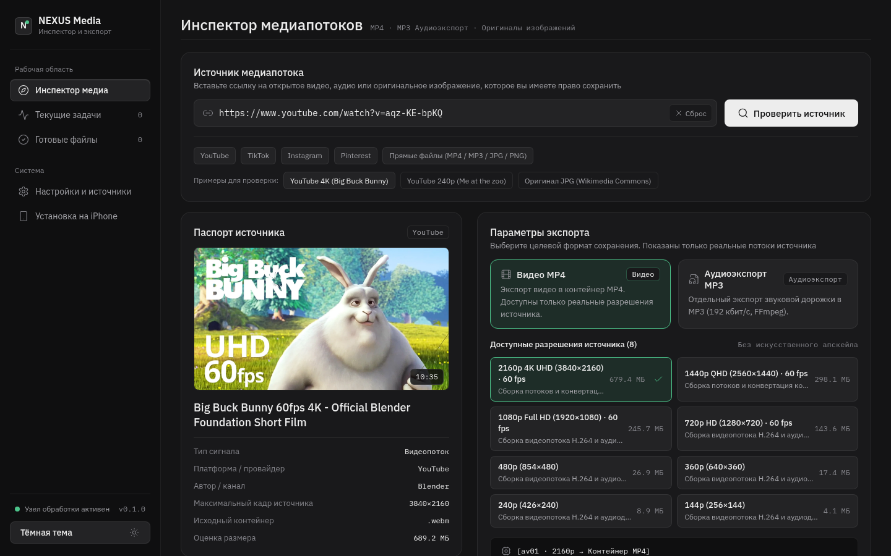
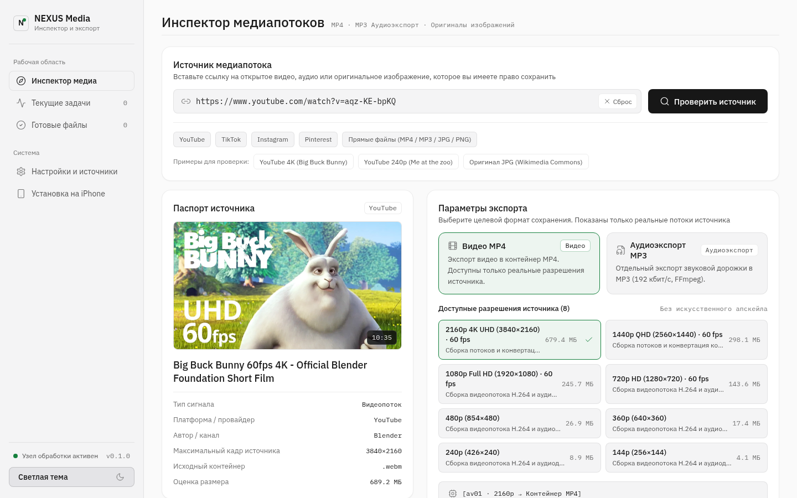
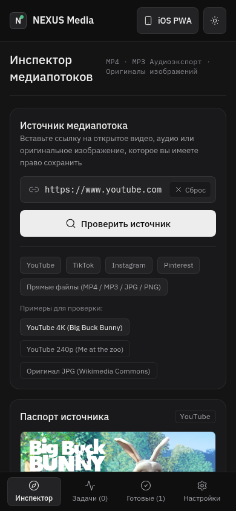
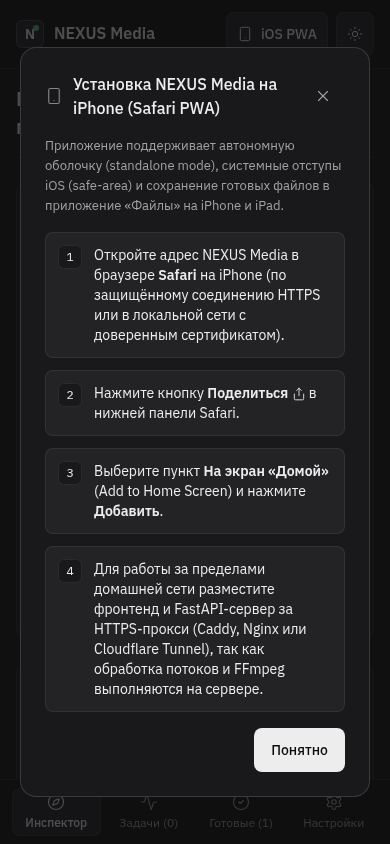
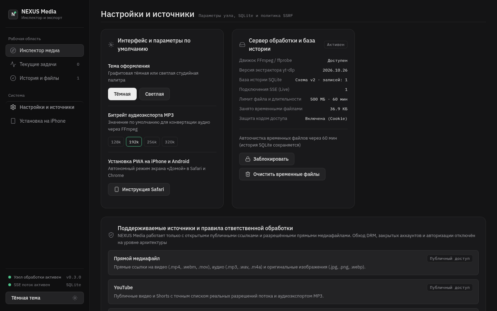
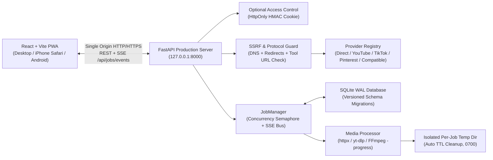

# NEXUS Media (`v0.1.0-beta`)

A self-hosted web application and Progressive Web App (PWA) for inspecting, converting, and exporting media that you own or have explicit permission to save.

Built with **FastAPI**, **React**, **TypeScript**, **SQLite**, **yt-dlp**, and **FFmpeg**, NEXUS Media provides a quiet, studio-grade interface in Russian for desktop browsers and mobile devices (iPhone Safari PWA & Android PWA).

> **Responsible Use Notice**
> NEXUS Media is strictly intended for media that you created, own, or have permission to download (such as your own uploads, Creative Commons / open-licensed assets, or authorized direct media files). It does **not** bypass DRM, login walls, paywalls, or private account restrictions. Users are solely responsible for complying with applicable copyright laws and platform Terms of Service.

---

## Interface Preview

| Desktop — Dark Theme (Real 4K Stream Inspection) | Desktop — Light Theme |
| :---: | :---: |
|  |  |

| Mobile iPhone PWA (`390×844`) | iOS Safari Installation Guide | Node Telemetry & Security |
| :---: | :---: | :---: |
|  |  |  |

---

## Core Features

- **Honest Stream Inspection**: Queries source metadata (`yt-dlp` / `ffprobe`) and presents **only resolutions that actually exist** in the source stream — never upscaled or invented options.
- **Explicit Format Separation**:
  - **Video MP4 (`Видео MP4`)**: Stream copy/remux or H.264/AAC transcoding with `+faststart` for desktop and iOS playback, clearly indicating when FFmpeg remuxing or transcoding is required.
  - **Audio Export MP3 (`Аудиоэкспорт MP3`)**: Clearly labeled as an audio export (never a video format) with selectable bitrates (`128`, `192`, `256`, `320 kbps`) via `FFmpeg libmp3lame`.
  - **Original Images**: Direct download of original `.jpg`, `.png`, `.webp`, and `.gif` files without recompression, verified with Pillow.
- **Persistent Job History (SQLite)**: Versioned SQLite migrations (`WAL` mode) store job history across restarts without storing media blobs in the database. Interrupted in-flight jobs are safely marked `INTERRUPTED_BY_RESTART` on reboot, while temporary file cleanup preserves historical records (`file_available` vs. `file_expired`) with one-click retry.
- **Live Progress via Server-Sent Events (SSE)**: Streams real measured download percentage, speed, and ETA (`GET /api/jobs/events`) with `Last-Event-ID` deduplication, automatic reconnection, iOS Safari foreground/background suspension recovery, and an honest indeterminate indicator when stream size is unknown.
- **Unified Production Server & Private Access**: FastAPI serves both the built React PWA (`frontend/dist`) and `/api/*` under one localhost-bound origin (`127.0.0.1:8000`), with optional `NEXUS_MEDIA_ACCESS_TOKEN` protection backed by HMAC-signed `HttpOnly; SameSite=Strict` cookies.
- **Defense-in-Depth Security**: Multi-layer SSRF protection across initial URLs, HTTP redirect chains, DNS resolution, `ffprobe` protocol whitelisting, and `yt-dlp` extracted stream URLs; isolated per-job temporary directories (`0700`); sliding-window rate limiting; strict subprocess argument arrays with zero shell interpolation.

---

## Architecture



---

## Supported Media Sources

| Source | Status | Supported Formats | Notes |
| :--- | :--- | :--- | :--- |
| **Direct Media URLs** | Verified E2E | Video (MP4), Audio Export (MP3), Original Image | Permitted public direct links (`.mp4`, `.webm`, `.mov`, `.mp3`, `.wav`, `.jpg`, `.png`, `.webp`). Verified on Wikimedia Commons JPG and MDN CC0 MP4. |
| **YouTube** | Verified E2E (public videos) | Video (MP4 with actual resolutions), Audio Export (MP3) | Verified on public open videos (4K & 240p inspection, MP4 + MP3 export). Private, members-only, and DRM streams are not supported. |
| **Pinterest** | Verified E2E (public image pins) | Video (MP4), Original Image | Public unauthenticated pins only (with SSRF-validated OpenGraph fallback for image pins). |
| **TikTok** | Unverified (ISP/TLS dependent) | Video (MP4), Audio Export (MP3) | Provider implemented for public unauthenticated clips, but could not be verified E2E because the test host's ISP times out TLS handshakes to TikTok (`504 SOURCE_NETWORK_TIMEOUT`). |
| **Instagram** | Limited public mode | Video (MP4), Original Image | Public unauthenticated posts only; Instagram frequently requires login, which NEXUS Media intentionally does not bypass. |
| **Other `yt-dlp`-compatible public sites** | Best-effort | Video, Audio, Image | Public pages such as Wikimedia Commons, Archive.org, or Vimeo where streams are openly accessible. |
| **DRM / Private / Login-Required** | **Not Supported** | — | Widevine/PlayReady DRM circumvention, cookie harvesting, and authentication bypass are explicitly excluded. |

---

## Requirements

- **OS**: Linux (developed on CachyOS / Arch Linux), macOS, or Windows (WSL recommended)
- **Python**: 3.11+ (tested on Python 3.13)
- **Node.js**: 20+ and `npm`
- **FFmpeg & ffprobe**: installed and available on `PATH`
- **uv** (recommended) or standard `python -m venv`

---

## Installation & Quick Start

### 1. Clone and install backend dependencies

```bash
git clone <repository-url>
cd NEXUS-Media/backend
uv venv .venv
uv pip install -e ".[dev]"
```

*(Or with standard Python `venv`: `python3 -m venv .venv && .venv/bin/pip install -e ".[dev]"`.)*

### 2. Install frontend dependencies and build production bundle

```bash
cd ../frontend
npm install
npm run build
```

### 3. Run in Unified Production Mode (Recommended)

In **fish** shell:
```fish
cd ~/Projects/NEXUS-Media/backend
source .venv/bin/activate.fish
# Optional: set a private access code before exposing over Tailscale Serve
set -x NEXUS_MEDIA_ACCESS_TOKEN "choose-a-strong-personal-token"
uvicorn app.main:app --host 127.0.0.1 --port 8000
```

In **bash / zsh**:
```bash
cd ~/Projects/NEXUS-Media/backend
source .venv/bin/activate
# Optional:
export NEXUS_MEDIA_ACCESS_TOKEN="choose-a-strong-personal-token"
uvicorn app.main:app --host 127.0.0.1 --port 8000
```

Open `http://127.0.0.1:8000` in your browser.

### 4. Development Mode (Hot Reload)

Run FastAPI (`uvicorn app.main:app --host 127.0.0.1 --port 8000 --reload`) in Terminal 1 and Vite (`cd frontend && npm run dev`) in Terminal 2, then open `http://127.0.0.1:5173`.

See [`.env.example`](.env.example) for all supported `NEXUS_MEDIA_*` configuration options.

---

## Private HTTPS Access for iPhone PWA (Tailscale Serve)

NEXUS Media is designed to remain bound to `127.0.0.1` and **should never be exposed publicly without authentication**.

For private remote access from your own iPhone over HTTPS (required by iOS Safari for Service Workers and standalone PWA installation), use **Tailscale Serve** within your private tailnet (**never** `tailscale funnel`). Full setup and teardown steps are documented in:

- [docs/TAILSCALE_PRIVATE_ACCESS.md](docs/TAILSCALE_PRIVATE_ACCESS.md)
- [docs/PWA_HOSTING_GUIDE.md](docs/PWA_HOSTING_GUIDE.md)

---

## Testing

```bash
# 1. Build frontend production bundle & run Vitest unit tests
cd frontend
npm run test
npm run build

# 2. Run full backend pytest suite (27 tests: security/SSRF, providers, SQLite, SSE, unified server)
cd ../backend
.venv/bin/pytest -v
```

---

## Honest Limitations (`v0.1.0-beta`)

- **Real iPhone Safari PWA Acceptance Pending**: Mobile layouts (`390×844`), anti-zoom `16px` inputs, Service Worker registration, `Content-Disposition` headers, and offline→online SSE recovery have been verified in automated Chromium mobile emulation, while physical iPhone Safari PWA download acceptance remains pending owner device testing.
- **TikTok Currently Unverified**: The TikTok provider is implemented for public unauthenticated clips, but end-to-end extraction could not be verified from the development host because upstream TLS handshakes to TikTok time out at the ISP/network level (`504 SOURCE_NETWORK_TIMEOUT`).
- **Instagram Depends on Public Availability**: Instagram frequently enforces login walls and IP-based limits; NEXUS Media intentionally does not bypass authentication or use session cookies.
- **Self-Hosted Backend Required**: The PWA frontend cannot execute `yt-dlp` or `FFmpeg` in the browser — self-hosting requires running your own local or private FastAPI backend server (e.g., over private Tailscale Serve).
- **Primary UI Language**: The user interface is currently in Russian; internal code, APIs, and contributor documentation are in English.
- **No Native Desktop Wrapper Yet**: Tauri desktop packaging is intentionally deferred to a future milestone.

---

## Third-Party Assets & Dependencies

- **Interface Screenshots**: Screenshots in `docs/screenshots/` include a thumbnail of *Big Buck Bunny* © 2008, Blender Foundation ([www.bigbuckbunny.org](https://www.bigbuckbunny.org)), used under [Creative Commons Attribution 3.0 (CC BY 3.0)](https://creativecommons.org/licenses/by/3.0/).
- **Fonts**: `IBM Plex Sans` and `IBM Plex Mono` (SIL Open Font License 1.1).
- **Icons**: `lucide-react` (ISC License).
- **External CLI Tools**: `FFmpeg` and `ffprobe` are invoked at runtime as separate user-installed system binaries and are not bundled or distributed in this repository.

---

## Contributing & Security

- Read [CONTRIBUTING.md](CONTRIBUTING.md) before opening pull requests.
- Read [SECURITY.md](SECURITY.md) for our threat model, SSRF defenses, and responsible disclosure guidelines.
- See [CHANGELOG.md](CHANGELOG.md) for release history.

## License

NEXUS Media's original source code is licensed under the **MIT License** — see [LICENSE](LICENSE) (`Copyright (c) 2026 localperson`).

> The MIT License applies **only** to the original source code of NEXUS Media. Third-party dependencies and assets remain subject to their respective licenses, and the MIT License does **not** grant permission to download or redistribute copyrighted third-party media.
